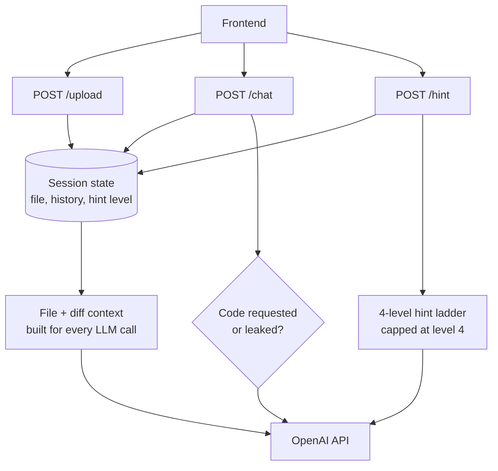

# AI Programming Tutor — Backend

A FastAPI backend for a hint-first Python tutor. Students upload a file, ask questions, and request progressive hints — the tutor explains and nudges instead of handing over working code, except when a student explicitly asks for it or reaches the final hint level.

## How it works

Three endpoints, one in-memory session store keyed by `session_id`:

- `POST /upload` — caches the student's file content for the session, resets hint progress
- `POST /chat` — free-form Q&A about the uploaded file, guarded against leaking code unless explicitly asked for
- `POST /hint` — a 4-level progressive hint ladder (concept → line pointer → explanation → solution), capped at level 4

## Architecture



## Modules

| File | Responsibility |
| --- | --- |
| `main.py` | FastAPI routes: `/`, `/upload`, `/chat`, `/hint` |
| `sessions.py` | In-memory per-`session_id` state — file content, chat history, hint level |
| `context.py` | Builds the system prompt's file context: numbered source + a plain-language diff since the last message, with changed lines tagged to their enclosing function |
| `chat_guardrail.py` | Decides whether a chat message explicitly asks for code (`wants_code`); if not, checks the model's response for a leak before it's returned (`chat_leaks_code`) |
| `hints/` | The 4-level hint ladder: prompts, the leak check shared with chat, and the service that ties a hint level to a prompt |
| `llm/client.py` | OpenAI client wrapper — streaming for ordinary chat, non-streaming where a response must be checked before being shown |

## The guardrail problem this solves

Early testing found the model would give full working code for implicit questions like *"how should I implement add?"* even though the system prompt said not to — prompt wording alone wasn't reliable. Both `/chat` and `/hint` now generate the response first, run it through a leak check, and only show it once it's confirmed clean (or retry with a tightened prompt, up to 3 times for chat). Code is allowed through directly only when the student's message is an explicit ask (`wants_code`) or they've reached hint level 4.

## Known limitation

Session state is in-memory and per-process: it does not survive a server restart, and does not scale across multiple instances. Fine for a single-student prototype; a real deployment would need a shared store (Redis, a database) instead of the `_sessions` dict in `sessions.py`.

## Running locally

```bash
pip install -r requirements.txt
cp .env.example .env   # add your OPENAI_API_KEY
uvicorn main:app --reload --port 8000
```

## Deployment

Deployed on Render as a standard Python web service:

- Build: `pip install -r requirements.txt`
- Start: `uvicorn main:app --host 0.0.0.0 --port $PORT`
- Env: `OPENAI_API_KEY` (required), `LLM_MODEL` / `LLM_BASE_URL` (optional, default to OpenAI's `gpt-4o-mini`)
