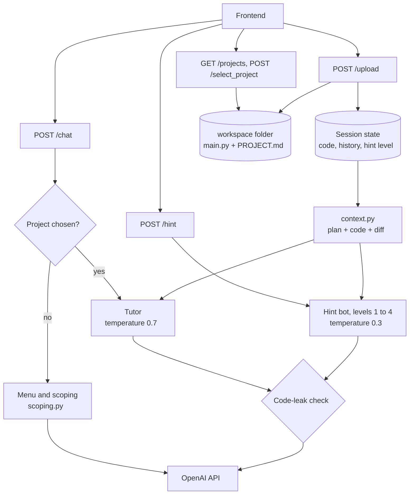

# Little by little — Backend

A FastAPI backend for a hint-first Python tutor. A student describes a small project, agrees on a short plan with the tutor, and then writes the code themselves in the editor. The tutor answers questions and gives progressive hints instead of handing over working code, except when the student explicitly asks for it or reaches the final hint level.

The prompts and hint logic come from the team's notebook (`Tutor_main.ipynb`). Everything that differs from the notebook is marked `(Added in the web version, not in the notebook:)` in `hints/prompts.py`.

## How it works

One in-memory session store keyed by `session_id` (one per browser tab), plus a `workspace/` folder with one folder per project.

1. **Menu and scoping.** The first messages in `/chat` go through a small state machine: `menu` → `pick` / `describe` → `scoping` → `tutoring`. For a new project the LLM drafts a short plan (name, goal, 3–5 features, out of scope). The student can ask for changes and types `yes` to accept. The plan is saved as `PROJECT.md`, and the student's code as `main.py`, in the project's folder.
2. **Tutoring.** Every chat message and hint request gets the plan, the student's current code and, for chat only, a unified diff of what changed since the previous message.
3. **Two LLM roles.** The *tutor* (chat, temperature 0.7) answers questions. The *hint bot* (Hint button, temperature 0.3) gives one short hint per press.

## Endpoints

| Endpoint | What it does |
| --- | --- |
| `GET /` | Health check |
| `GET /greeting` | The first message (the 1 / 2 menu) |
| `GET /projects` | Names of all saved projects, for the sidebar |
| `POST /select_project` | Opens a saved project: starts tutoring on it and returns its saved code |
| `POST /upload` | Saves the student's current code from the editor (to the session and to the project folder); resets hint progress |
| `POST /chat` | Menu / scoping before a project is chosen, then free-form Q&A, guarded against leaking code unless asked for |
| `POST /hint` | The next level of the hint ladder |

## Architecture



## Hints

- **Four levels:** (1) the concept, (2) the problematic line, (3) an explanation in words, (4) the solution. Levels 1–3 never contain code; level 4 may.
- **Same problem across levels.** The hint bot's earlier hints are passed back as conversation turns (`hint_history`), so all four levels stay on one problem. The level and history reset when the saved code changes.
- **Line numbers.** Hint calls get the code with line numbers so that level 2 can name the right line. Chat gets the raw code (`NUMBER_LINES` / `HINT_NUMBER_LINES` in `context.py`).
- **Correct code.** If the code has no real bug, the hint says so and points to the first unwritten feature in the plan. Hints never suggest anything the plan lists as out of scope.
- **Empty editor.** With no code written yet, hints help the student get started on the plan's first feature (level 4 shows a short starter).
- **After level 4.** Pressing Hint again without changing the code returns a fixed message and does not call the model.
- **Tutor sees the hints** in a separate "Hints so far" section of its context, not as chat turns (stored as turns, the tutor started imitating the hint format).

## Modules

| File | Responsibility |
| --- | --- |
| `main.py` | FastAPI routes (see the table above) |
| `sessions.py` | In-memory per-`session_id` state, plus creating, listing and loading project folders under `WORKSPACE_DIR` |
| `scoping.py` | The menu → scoping flow: greeting, plan prompt, `format_spec` (blank lines in the plan), start message |
| `context.py` | Builds the context for every LLM call: plan + code + unified diff (`difflib`), and the "Hints so far" list for the tutor |
| `chat_guardrail.py` | Decides whether a chat message explicitly asks for code (`wants_code`); if not, checks the answer for a leak (`chat_leaks_code`) |
| `hints/prompts.py` | The tutor and hint-bot prompts, the hint level instructions, temperatures |
| `hints/service.py` | Generates a hint at a level, checks it, and retries or falls back |
| `hints/leak_check.py` | `leaks_code` (code fences, code-looking lines) and `leaks_inline_code` (hints only: backticked code that is not already in the student's code) |
| `llm/client.py` | OpenAI client wrapper — streaming for ordinary chat, non-streaming where a response must be checked before being shown |

## The guardrail problem this solves

Early testing found the model would give full working code for implicit questions like *"how should I implement add?"* even though the system prompt said not to — prompt wording alone wasn't reliable. Chat answers and hints at levels 1–3 are now generated first, run through a leak check, and shown only once they are clean (or regenerated with a tightened prompt, up to 3 times, then replaced by a generic fallback). Code is allowed through directly only when the student's message is an explicit ask (`wants_code`) or they've reached hint level 4.

## Known limitations

- **Sessions are in memory.** They don't survive a server restart and don't scale across instances. A real deployment would need a shared store (Redis, a database) instead of the `_sessions` dict.
- **Projects are on the server's disk.** On Render's free tier the disk is wiped on every restart or redeploy, so saved projects disappear. A persistent disk or a database would fix this.
- **No accounts.** `GET /projects` lists every project in the workspace, so visitors can see and overwrite each other's saved code and plans (chat history is not shared).
- **CORS is open** (`allow_origins=["*"]`); lock it down to the frontend's domain before real use.

## Running locally

```bash
pip install -r requirements.txt
cp .env.example .env   # add your OPENAI_API_KEY
uvicorn main:app --reload --port 8000
```

## Deployment

Deployed on Render as a standard Python web service:

- Build: `pip install -r requirements.txt`
- Start: `uvicorn main:app --host 0.0.0.0 --port $PORT`
- Env: `OPENAI_API_KEY` (required), `LLM_MODEL` / `LLM_BASE_URL` (optional, default to OpenAI's `gpt-4o-mini`), `WORKSPACE_DIR` (optional, where project folders are stored, default `workspace`)
